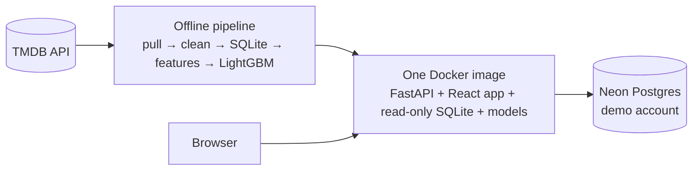

# Movie Prediction App

Creators enter a planned movie's parameters and get ranges for **budget**, **revenue** and **audience score**, each with the top factors behind it. The public can browse and search movie information.

Every prediction is a range: a low end (10th percentile), an expected value (50th) and a high end (90th). The ranges are calibrated so that about 80% of real outcomes fall inside them.

**Stack:** Python, pandas, LightGBM, Optuna, ONNX Runtime, SQLite, FastAPI and React (Vite). All data comes from our own TMDB API pull.

**Live:** https://movie-prediction-2f1b0265282c.onrender.com (Render Free: it sleeps after 15 idle minutes, so the first visit takes about 1.5 minutes; see [Deployment](docs/deployment.md#deployment-day-15)).


**What it does:**
- **For creators:** a form for a planned film (genres, themes, director, cast, budget, release month…) gives three calibrated ranges, the drivers behind each, comparable earlier films, a break-even band, "what if" variants and the best release month.
- **For everyone:** a header search for films or people (actors, directors, writers), browse 80,398 films (1960 to 2026) with a New arrivals row of what came out in the last two weeks and what is due in the next two months, film and person pages with career charts, a demo account with lists, ratings and notes, and a "Surprise me" picker.

## Targets

| Target  | Definition                         | Source field                      | Units                                                  |
| ------- | ---------------------------------- | --------------------------------- | ------------------------------------------------------ |
| Revenue | Worldwide box-office gross         | TMDB `revenue`                    | Nominal USD, plus `revenue_2025` in 2025 dollars       |
| Budget  | Production budget                  | TMDB `budget`                     | Nominal USD, plus `budget_2025` in 2025 dollars        |
| Score   | Average TMDB user rating (0–10)    | TMDB `vote_average`               | Films with at least 50 votes, weighted by log(1 + votes) |

A value of `0` in TMDB's `budget` or `revenue` means "unknown", not zero. See [Cleaning rules](docs/data.md#cleaning-rules).

## Working principles

- **Pre-release inputs only.** Every model input must be something a creator knows before the film exists. Post-release fields (`popularity`, `vote_count`, `vote_average`) are never features.
- **Time-based splits.** Every evaluation uses the same splits, and the test set was opened only once, at the end of Day 6.

  | Split      | Release years |
  | ---------- | ------------- |
  | Train      | ≤2015         |
  | Validation | 2016–2018     |
  | Test       | 2019+         |

- **Baselines.** Every model is compared with simple baselines, and [Evaluation](docs/evaluation.md) reports where it does and doesn't beat them.
- **One feature function.** Training and the live app share one feature function, so the two can never drift apart.

## Key results (test, 2019+)

The test split was opened once, after everything was frozen; models trained on films up to 2018 were scored on 2019+ films. Full tables and groups: [Evaluation](docs/evaluation.md#final-test-results-2019).

| Target | Films | LightGBM error | Best baseline (B2) | Range coverage (target 80%) | Typical range |
| --- | --- | --- | --- | --- | --- |
| Revenue, budget given | 1,485 | MAE log **1.230** (41% within 2×) | 1.455 (36%) | 77.4% | 34× |
| Revenue, budget estimated | 1,485 | MAE log **1.266** (39% within 2×) | — | 78.2% | 42× |
| Budget | 1,964 | MAE log **0.682** (67% within 2×) | 1.247 (34%) | 79.9% | 7.6× |
| Score | 7,461 | MAE **0.493** points | 0.574 | 81.1% | 1.67 points |

- **All three models beat the baseline** on the test years. The one group where they don't is revenue for $150M+ films (see [Limitations](#limitations)).
- **Wide ranges are the honest answer:** a film's box office is hard to predict before release, so revenue ranges span about 34× while still holding only about 77% of real outcomes.

## Architecture



Python (pandas, LightGBM, ONNX Runtime for the MiniLM synopsis model) builds the data and models offline; FastAPI serves predictions and the movie database from one container on Render, with the React app on the same origin. More, with the path of one prediction: [Architecture](docs/architecture.md).

## Documentation

| Document | What's in it |
| --- | --- |
| [Architecture](docs/architecture.md) | The system and the path of one prediction, as diagrams |
| [Data and features](docs/data.md) | The TMDB pull, the cleaning rules and every model input |
| [Models and explanations](docs/modeling.md) | The LightGBM models, validation results, ablation, drivers and comparable films |
| [Evaluation and testing](docs/evaluation.md) | Baselines, the time-split evaluation, the 2019+ test, the audit and the test suite |
| [API](docs/api.md) | Every endpoint, errors, limits and speed |
| [The app](docs/app.md) | The React app, the demo account, Surprise me, person pages and the Career section |
| [Running with Docker and deployment](docs/deployment.md) | The one image, memory, and the live site on Render |
| [Decisions](docs/decisions.md) | Each key choice, the alternatives and why |
| [Model card](MODEL_CARD.md) | Intended use, data, metrics, failure cases and limitations |

## Setup

Requirements: [uv](https://docs.astral.sh/uv/) and GNU make. uv installs Python 3.11 for the project.

```bash
make setup                 # create .venv and install locked dependencies
make model                 # download the MiniLM text model (about 90 MB, once) and make its 8-bit copy for the app
cp .env.example .env       # then paste your TMDB API Read Access Token into .env
make test                  # offline tests, no network needed (about 1 min in a fresh clone, 2.7 min with the data and models)
make test-fast             # the quick loop: no slow or real-data tests (about 35 s)
make coverage              # every test with line and branch coverage
make data                  # pull films from TMDB (resumable), build data/movies.db, then the features table
make db                    # rebuild data/movies.db from the raw pull only (about 30 s; drops the features table)
make features              # build the features table (about 1 min; the first run also embeds every overview, about 8 min)
make tune                  # tune the LightGBM settings on backtest folds 1-2 (15 min per target, 45 min in all)
make train                 # calibrate the ranges, then fit and save all three models to ml/artifacts/ (about 5 min)
make evaluate              # baselines and LightGBM on validation, breakdowns and backtest -> reports/ (test split untouched)
make api                   # the API on http://localhost:8000, docs at /docs (needs the database and the app's models)
make docker-build          # the app's one image (see Running with Docker); make docker-run, make smoke
make deploy                # build from this commit, push to GHCR and deploy on Render (see Deployment)
make web-setup             # the frontend's packages (needs Node 24); then make web for http://localhost:5173 (see Frontend)
make web-test              # the frontend's types, lint and tests
uv run python -m ml.models.rough           # the rough-estimate cut-offs (fitted once on Day 6, then frozen)
uv run python -m ml.eval.final test        # the one-time test run (done on Day 6; refuses to run again)
uv run python -m ml.eval.final all-data    # retrain the app's models on 1960-2025 -> ml/artifacts/final/ (about 1 min)
uv run python -m ml.explain.comparables    # the comparable-films index -> ml/artifacts/final/comparables.npz (3 s)
uv run python -m ml.predict manifest       # checksums of the app's model files -> ml/artifacts/final/manifest.json
```

| Folder       | Contents                                         |
| ------------ | ------------------------------------------------ |
| `ml/`        | Data pull, features, models and evaluation; `ml/artifacts/` holds the PCA and the models' settings, calibration and metadata (committed), the MiniLM files and the trained `.joblib` models (not in git; `make model`, `make train`); `ml/artifacts/final/` holds the app's all-data models, their `manifest.json` and the comparables index; `ml/explain/` and `ml/predict.py` turn them into explained predictions |
| `backend/`   | FastAPI app: `backend/app/` with one router per resource, schemas, read-only repo queries and services ([API](docs/api.md#api)) |
| `frontend/`  | React app: the creator form, the API client and types ([Frontend](docs/app.md#frontend)) |
| `data/`      | Raw pull and database (not in git), CPI table, summaries |
| `tests/`     | Offline tests, the end-to-end fixture and the golden forms ([Testing](docs/evaluation.md#testing)) |
| `scripts/`   | `slim_db.py` (the image's database copy), `smoke.py` (checks a running API and app), `deploy.py` (`make deploy`) and `warmup.py` (`make warmup`, before a demo) |
| `notebooks/` | Exploration and check notebooks                  |
| `reports/`   | Evaluation reports from `make evaluate`, the ablation and the final test run (committed) |

## Limitations

- **The autocomplete extras run on every keystroke.** `GET /people` adds the photo and known-for film (one SQL query, 7–30 ms in Docker) for the form's director and actor fields, which never show them; on a slow host that could add up. If it does, drop them (browse's people row that used them is gone since V1.1).
- **A 2-letter people search ranks thousands of names.** "ma" matches 34,337 people; only those who could reach the page are counted exactly, so it takes up to about 50 ms locally (a full name takes 1–10 ms).
- **Actors with one film have no TMDB photo or biography,** and TMDB has photos for few crew. The person pull covers the 118,244 cast members with 2+ films and every crew member; the other 203,000 actors get a page from our data only, and 29% of cast slots on film pages show initials. Only 29% of crew (57% of directors) have a photo. Biographies are TMDB's English ones, and 71% of the people pulled have none.
- **Producers, composers, cinematographers and editors can't be searched.** They have pages but no search index; they are reached from film pages. Actors, directors and writers can (writers since V1.1, a 3.9 MB index).
- **The revenue model is mostly an English-language, post-1980 model.** Only 21% of English films have both budget and revenue (32% among the first 700 per year), and most other languages are under 10%. There are only 286 revenue training films from the 1960s and 471 from the 1970s.
- **Some revenues are incomplete.** 178 training films (2.0%) earned less than 1% of their budget. Some are real flops, but others seem to record only part of the box office, probably the US share (e.g. *Flying Swords of Dragon Gate*, $128k). No rule catches these yet.
- **Local-currency budgets are only caught when they're extreme.** The currency rule flags budgets far above their language's norm. Smaller mistakes sit near the cap: a budget entered in Brazilian reais (about 3.5 to the dollar in 2016) is only around 3.5× too high, and *The Ten Commandments: The Movie* was flagged only narrowly.
- **US certification is missing for 65% of films**, so the creator form has an "unrated/unknown" option (70.5% of films, counting NR).
- **Track-record scores use today's ratings.** An earlier film's score is its current TMDB rating, not its rating when the later film came out; the pull has no rating history.
- **COVID can't be learned from training data.** `covid_period` is always 0 in the train split, because 2020–21 films are all in the test split.
- **Revenue with an estimated budget is less accurate.** When a creator leaves the budget out, the app predicts it first; validation MAE log rises from 1.093 to 1.135 (test: 1.230 to 1.266), and the ranges widen from about 34× to 42× on the test years.
- **Coverage close to 80% overall can hide groups that are far off.** For example, B2 revenue covers 100% of $150M+ films but 72% of films under $10M. LightGBM narrows this to 82–91% on 2016–18, but on the test years it covers only 64% of $150M+ revenue films and 74–77% of $50M+ budgets. `reports/breakdowns.md` and `reports/final_test.md` have the coverage for each group.
- **Big-budget revenue is no better than the simple baseline on the test years.** For $150M+ films from 2019 on, LightGBM's revenue error (MAE log 1.04) is slightly worse than B2's (0.99), and its ranges are too narrow (64% coverage). Why isn't known yet; the test split stays closed, so it can only be studied on newer films.
- **The app's models have only a small test of their own.** They are retrained on 1960–2025 and reuse the ≤2018 corrections and tree counts. The 2019+ results above estimate their accuracy, and the 2026 holdout (70 revenue, 223 budget and 190 score films) confirms the money models; a bigger check needs a pull in 2027.
- **Young films' scores are still settling.** TMDB scores start high, when fans vote first, and drift down. 2026 films under six months old score +0.41 above the app's middle, and those 6–12 months old +0.17, so score ranges cover 60% and 74% of them instead of 80%. The ranges describe a film's settled score, and `predict()` says so in `score.note`.
- **Releases after 2025 look slightly worse the further away they are.** The track record's "years active" keeps growing after the data ends, although no new films can be counted: the same small drama's revenue middle falls from $23M in 2026 to $17M in 2030.
- **Revenue stops rising with the budget above about $300M.** Trees can't extrapolate past the 130 training films with a budget over $250M, so $300M, $400M and $1B give the same revenue. The big-budget warning says so.
- **Coverage is uneven in some groups on 2016–18:** budgets of films under $10M (77%, with 22% cheaper than the low end), and the scores of animated (72%) and romance (74%) films, which are mostly higher than the high end.
- **The revenue and score settings were tuned with the synopsis numbers included and without the budget track record.** The ablation dropped the synopsis afterwards and Day 6 added the budget track record to revenue; the settings were reused without retuning. The budget model was tuned on Day 6 with its saved features, and `make tune` now tunes every model with its saved features.
- **Synopsis meaning doesn't help yet.** MiniLM embeddings reduced to 16 or 32 numbers add nothing beyond genres and themes. Other text features remain an open question.
- **Drivers describe the model, not causes.** "A budget of $40M strongly raises the expected revenue" says what the model leans on for films like this one; spending more would not by itself earn more. The drivers explain the middle prediction only, not the width of the range.
- **Breakouts stay outside the range.** *Get Out* earned $340M against a range of $160K–$59M, even with the all-data models that saw it in training; its drivers (small budget, new director, small studios) describe the typical film like it.
- **Empty optional fields count against a film.** No production country or studio looks like the obscure films in the data that have none (no country: about −38% revenue for a small horror film). `predict()` warns about it.
- **"Predict a film like this" carries only part of a film.** It leaves out the studio, country, franchise, budget and synopsis, and takes the first credited director when there are two (the form has one).
- **Cast and crew have no photos.** The pull didn't fetch people's images, so the film page shows initials avatars.
- **The default browse order is TMDB's popularity on the day of the pull.** It is a trending number, so the first page starts with *Clue* (1985) rather than the best-known films.
- **The per-IP limits trust Cloudflare's `CF-Connecting-IP` on Render.** It can't be forged through Render's edge, but the app takes it from any request that has it, so on a host without Cloudflare `CLIENT_IP_HEADER` must stay unset. Whether two visitors behind one Cloudflare edge are counted apart was checked from one machine only.
- **The live site is slow where several predictions run in a row.** On Render Free's 0.1 CPU a prediction takes about 2.2 s (0.2 s locally), the career section's model films 6 s and the 12-month sweep about 25 s, with no progress shown beyond the slow-host notice. The first visit after 15 idle minutes waits about 84 s for the wake-up as well (the app shows its slow-host notice after 3 s); open the site a couple of minutes before a demo.
- **Sentry is wired up but not active:** no DSN is set on Render or in the bundle yet.
- **Everyone shares the demo account.** Its lists and "private" notes are private to the account, not to a visitor: anyone logged in to it sees and can change them until the nightly reset.
- **Undo on a deleted note adds it back as a new note,** at the top of the list with today's date.
- **The examples are dated October 2026 and May 2027,** like the golden forms they send. Once a date has passed, the year list (this year to four years ahead) no longer offers it, though the form still sends it.
- **The Docker image is 1,097 MB unpacked, above the ~700 MB aim** (about 411 MB compressed). The Python packages take 489 MB (441 MB before Day 14's Postgres and argon2 packages), scipy alone 143 MB; the database 293 MB, 73 MB of it the person details (Days 14.6–14.7): LightGBM imports `scipy.sparse` when it loads, so scipy can't be left out. The 100 MB of precompiled bytecode stays, so startup doesn't recompile everything.
- **Startup peaks at 456–489 MB.** That is under Render Free's 512 MB, but not by much: a bigger database or model would need another look.
- **The app embeds a synopsis with an 8-bit model, the comparables index holds full-model vectors.** They agree closely (mean cosine 0.993), but for about 1 synopsis in 10 the nearest overview differs, so a comparable can differ from what the full model would pick.
- **Memory measurements depend on the system.** On Windows the same app keeps more freed memory (639 MB after startup before the cuts); `malloc_trim` works on Linux only. The gate is measured in Docker, like the host.
- **Some comparable films are obscure.** *Get Out*'s are small horror films scored about 4.5–6. A tie-break towards well-known films was tried and made the comparables' revenue less like the film's own, so it was dropped.
- **The break-even zone is a rule of thumb.** 2–2.5× the budget assumes cinemas keep about half the box office and marketing costs a large share of the budget on top. It ignores streaming, TV and home sales and each film's own deals, so the results page shows it as a shaded band, not a probability of making money.
- **"Within the uncertainty" is a rule of thumb, not a significance test.** A tenth of the median validation range is a set share, chosen on Day 13, not a measured noise level. Two versions of one film share most of their error, so a smaller change may still be real. A larger one can still be the model's quirk: the unknown-cast variant also moves the themes driver.
- **The month sweep only moves the release month.** Everything else stays as planned. The models know a month's typical effect, not the competition a film would meet that month.
- **Firefox wasn't checked automatically.** Playwright's Firefox build wouldn't start on this machine; Chromium (Edge) and WebKit were. A real phone check is still to do.
- **"Why similar" tags use hand-set cut-offs** (synopsis cosine 0.5, within 2× the budget, about 5 years); they name the parts of the similarity that matched, not a measured reason.
- **Themes depend on TMDB's keywords.** Only 48% of films have a theme, and some keywords are loose: "rape" puts *The Revenant* in "sex and erotica", and "hilarious" puts some action films in "comedy and satire".

## Next steps

- A movie chat assistant.
- IMDb score (via OMDb) as an alternative score target.

## How it was built

I built this project with Claude Code, an AI coding assistant, from 21 to 29 October 2026: 80 commits over Days 1–16, plus an audit after Day 7 and four extra days I added along the way (14.5–14.8: Surprise me, actor pages, crew pages and the Career section). We split the work clearly. I set the goals, made every decision and did everything that needs a person: accounts, tokens, the live dashboards, recording the demo. Claude wrote the code, ran the checks and reported what it found.

### A plan, then a record

- **A written plan first.** I wrote a day-by-day plan in three documents (Days 1–5, 6–10, 11–16). Each day had numbered tasks, and each task said what "done" means.
- **Decisions before code.** Each day started with the open questions, usually 2–4 choices with a recommended option, such as a private image or a public one, or a daily smoke test instead of uptime pings. I chose, and my answers went into the plan document before any code was written.
- **A record of what really happened.** [PROGRESS.md](PROGRESS.md) holds each day's checklist, its numbers, "Changes from the plan" and "Surprises / inputs for the next day". When the plan turned out wrong, we wrote the change down instead of making it silently: LightGBM refuses monotone constraints on quantile models, so revenue got a different model shape; the conformal calibration became our own function instead of MAPIE; Day 14's accounts replaced a chat-assistant day that was never built.
- **One step at a time.** Each task ended with its tests and a commit. A day was closed only after I approved it, and nothing was pushed, merged or deployed without my say.

### Evaluation: deciding the rules first

- **The rules came before the models.** I fixed pre-release inputs only, time-based splits and baselines B0–B2 on Days 1–4, before any LightGBM model existed. Tests enforce them, so they don't depend on anyone remembering: the test split raises `TestSetLocked` unless one script asks for it, and a test checks that no other file does.
- **The test was opened once.** On Day 6 we froze everything and tagged it (`pre-test`). A dry run with 2016–18 standing in for the test split reproduced every validation number, and only then did the real run happen, once, in 259 s. The script refuses a second run. The results, disappointments included, went into the README as they came out, and I didn't change the models because of them.
- **Evidence decides features.** We built the synopsis embeddings and measured them in an ablation (−0.006 MAE log for revenue: nothing), and I dropped them. A tie-break towards well-known comparable films was tried and dropped for the same reason.
- **Checking the checks.** We planted bugs on purpose to see whether the tests catch them: a leak of the monotone columns, an off-by-one in the conformal quantile, a second test run, same-day comparables. Each one was caught. One that survived (unsorted crossed quantiles) was examined and written down as harmless.
- **An outside look.** After Day 7, I asked for an audit of everything from Day 1. It refitted all 13 models (difference 0 from the reports), added 42 sanity tests on the real models and scored the app on a fresh 2026 holdout. Findings that would change frozen models weren't applied. They came to me as options, and I picked which to apply (two became text in the app).

### Failures: written down, not hidden

- **Weak spots are in the README.** The models don't beat the baseline on revenue for $150M+ films, young films' scores are still settling, and the image is above its size aim. Each is a Limitation with its numbers.
- **Mistakes are in the record too,** Claude's and mine: PROGRESS.md records each one with its fix (for example Day 15's "Mistakes, fixed").
- **Bugs found by hand get a test.** Clicking before login could wipe a rating; fast arrow-key presses could save 1/10 instead of 8/10. Both were fixed before the commit, with tests. A forged `X-Forwarded-For` header got around the login limit on the live site; we tested the fix again live, header by header.
- **Changing course is allowed.** I asked for a revenue view in the Career section, and later decided to remove it again. The record keeps both steps.

### What the collaboration was like

- **I steered, Claude proposed.** Claude gave a recommendation with each question, but the call was mine: dropping the synopsis, removing the revenue view, choosing the Frankfurt region.
- **Each of us did what the other couldn't.** Claude can't create accounts or handle passwords, so I made the TMDB, GitHub, Neon and Render accounts and tokens. Claude ran the migrations, pushed the images and tested the live site.
- **"Done" means checked.** A task counted as done when its tests passed and its numbers were measured, not when the code was written. The project ends with 595 Python tests, 280 frontend tests, a Playwright demo flow and a daily smoke test of the live site.
- **Plain writing.** The plan, PROGRESS.md and the docs use short sentences with concrete numbers, so either of us could pick up the next day from the written record alone.

## Attribution and TMDB terms

The code is under the [MIT License](LICENSE). The film data and images come from TMDB under its own terms:

- Free for non-commercial use with attribution. Every page carries TMDB's "Primary short" logo (in the footer, or under the start page's cards) (`frontend/public/tmdb-logo.svg`, byte for byte their file: its SHA-256 equals the checksum in TMDB's own file name), smaller than our own brand, with the notice below and a link to TMDB. Film pages also link to the film on TMDB.
- Data is not cached for more than six months. That includes the start page's two poster collages (`make collages`) and the person details (`ml.data.people pull --refresh-older-than 180`): refresh them at least every six months.
- The client stays at about 20 requests/second, well under TMDB's per-IP limit.

> This product uses the TMDB API but is not endorsed or certified by TMDB.
