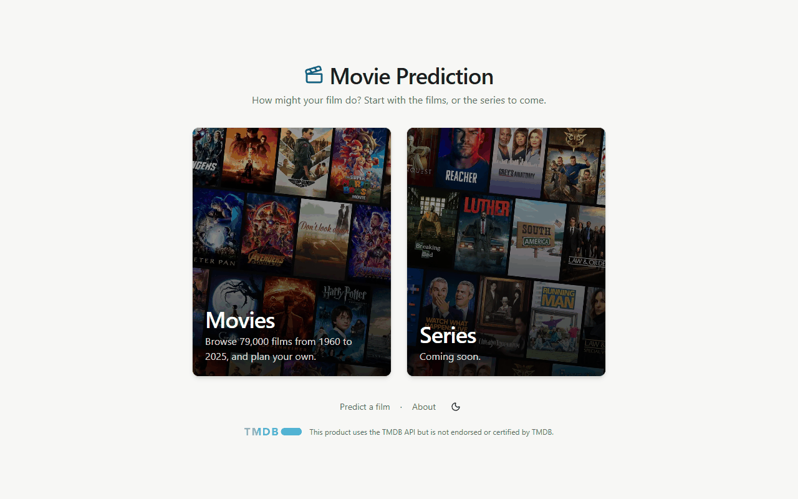
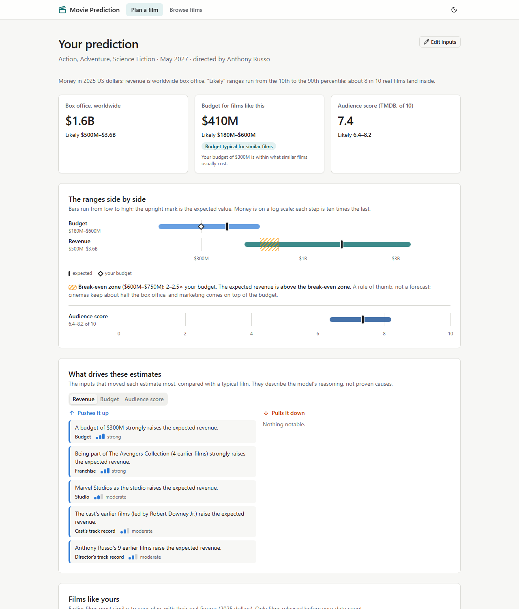
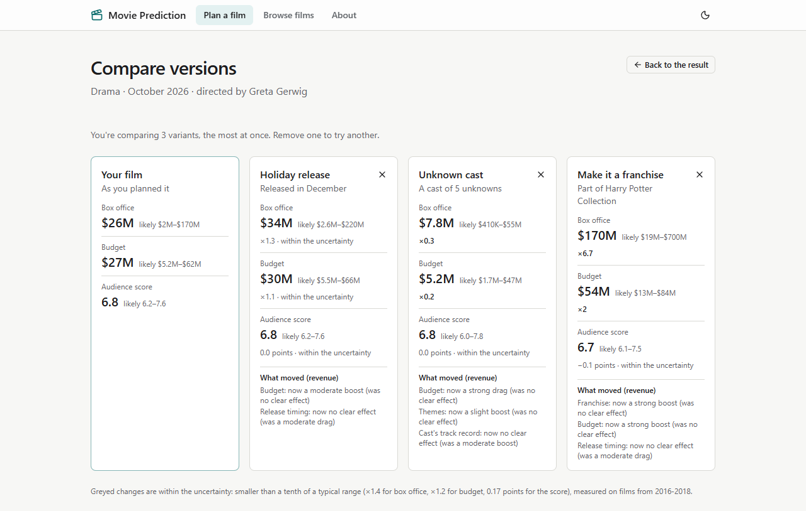
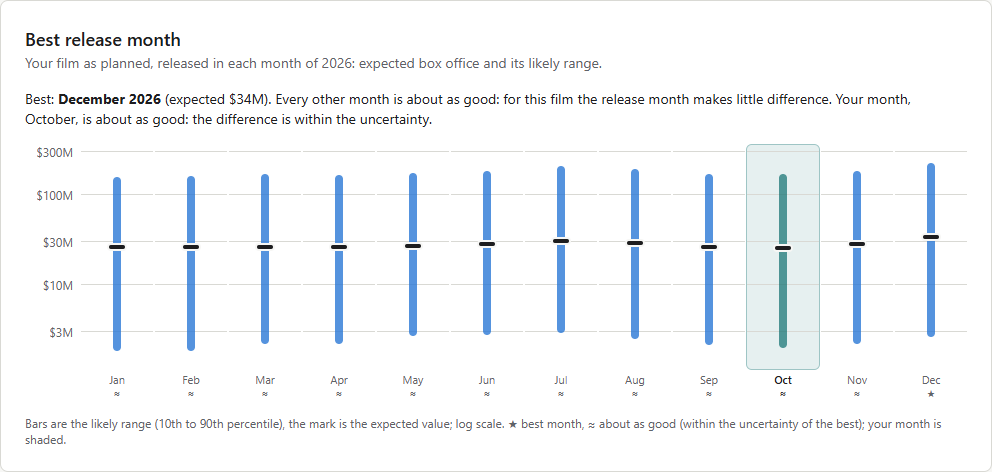
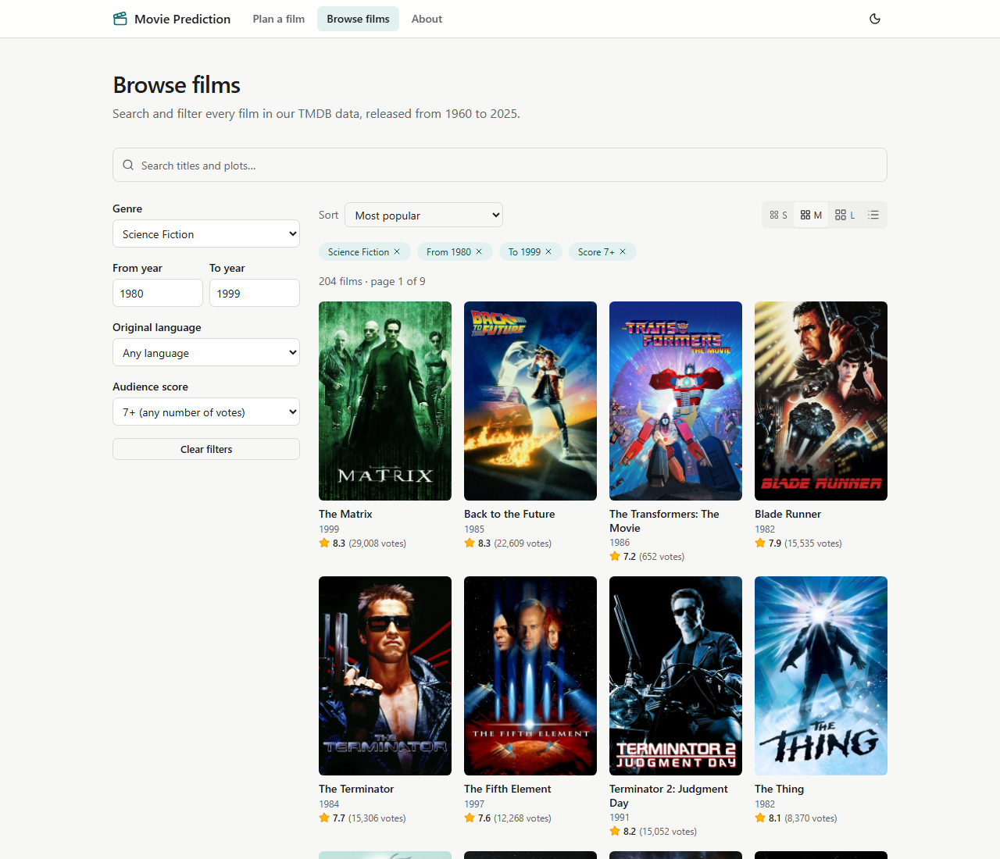
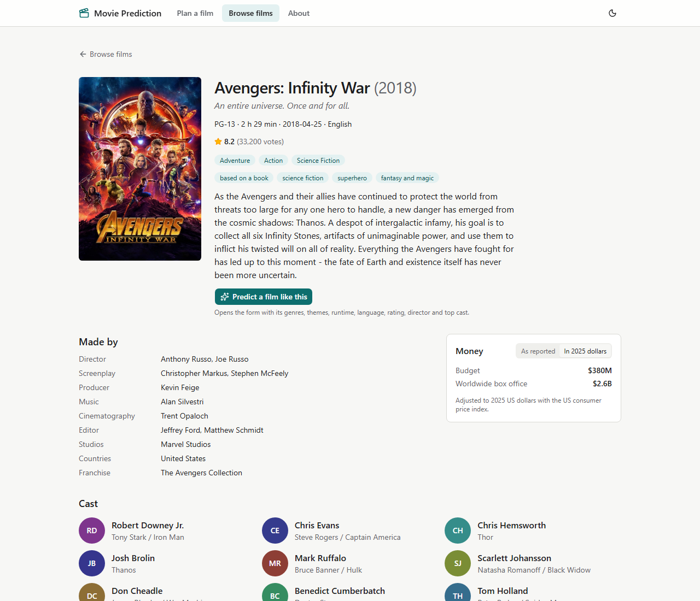
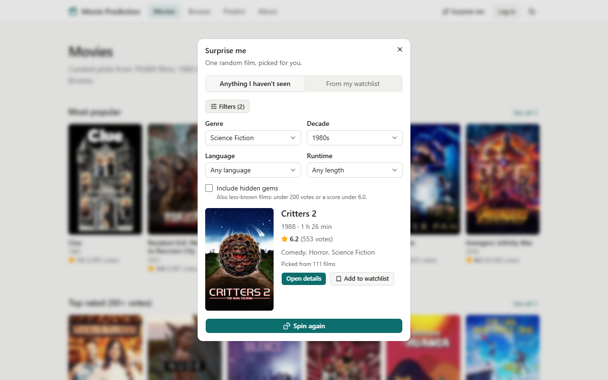
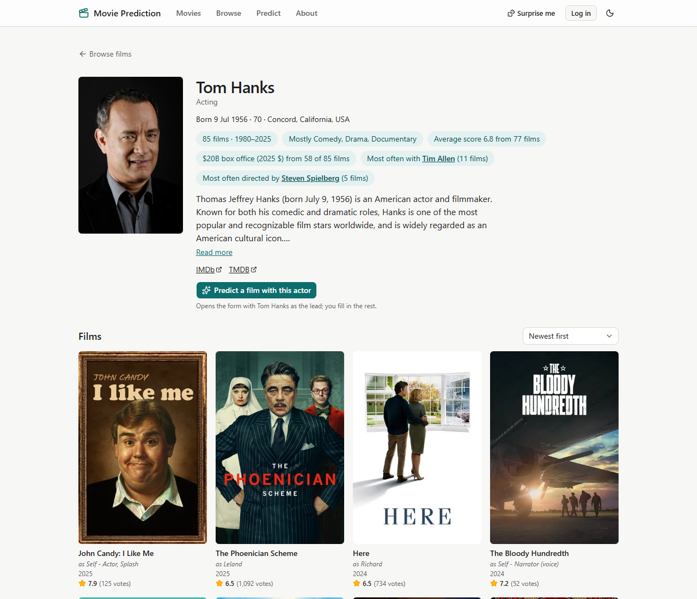
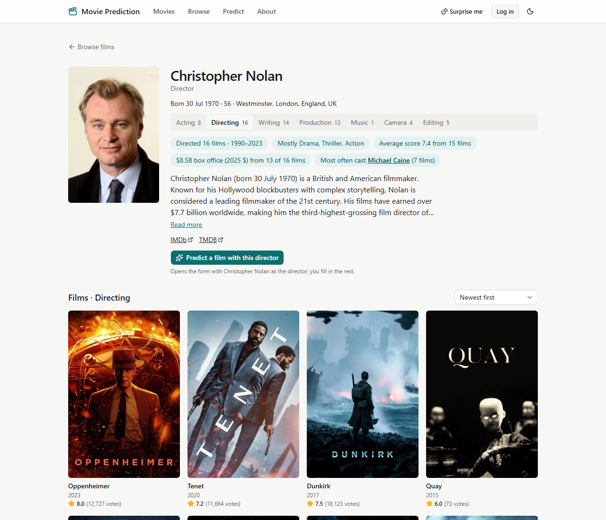
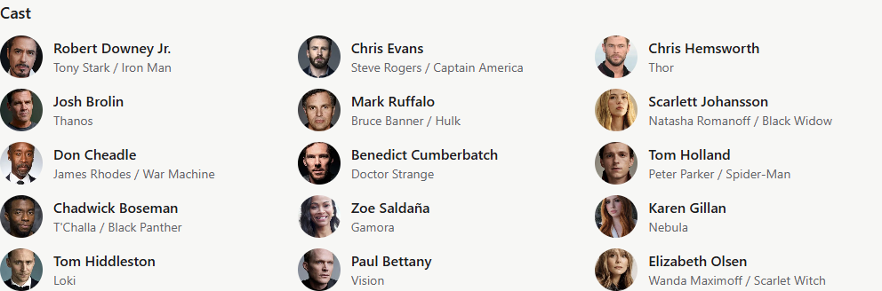

# The app

The React app and the features built on the API: the demo account, Surprise me, person pages and the Career section. Back to the [README](../README.md).

## Frontend

A React app in `frontend/` (Vite 8, React 19, TypeScript 6, Tailwind 4 with shadcn/ui, React Router 8, TanStack Query 5, React Hook Form + Zod 4). It needs Node 24.

```bash
make web-setup   # npm ci, once
make api         # the API on :8000 (the dev server proxies /api to it)
make web         # the app on http://localhost:5173
make web-test    # types, lint (oxlint) and the Vitest tests
make gen-api     # regenerate src/api/schema.d.ts from the running API's /openapi.json
make collages    # the start page's poster collages (needs data/movies.db and TMDB_READ_TOKEN; commit the two images)
cd frontend && npm run coverage
```

| Path | What it holds |
| --- | --- |
| `src/app/` | routes, layout (header, navigation, footer with the TMDB notice), theme, providers |
| `src/api/` | the typed client (`client.ts`), the hooks (`hooks.ts`), shared error handling (`errors.ts`), and `schema.d.ts` generated from the API |
| `src/form/` | the creator form: values and Zod rules (`model.ts`), the examples, the URL and draft (`persist.ts`), and its inputs (`inputs/`) |
| `src/pages/` | the start page `/`, `/series` (coming soon), `/movies` (curated rows), `/browse` (filters and the movie results), `/people` (the people results), `/predict`, the results page `/predict/result`, the compare page `/predict/compare`, `/movies`, `/movies/:id` and `/about` |
| `src/auth/`, `src/me/` | the session (`session.ts`), the login choices and dialog, the account menu; the lists and notes hooks (optimistic, `hooks.ts`), the list control, stars, notes, card badges and the `/my-movies` URL state |
| `src/search/` | the header search (V1.1): the rules (`search.ts`), the box with its switch and quick results (`SearchBox.tsx`), the header and phone overlay (`HeaderSearch.tsx`) and the wrong-mode hint (`ModeHint.tsx`) |
| `src/movies/` | the public side's parts: the browse state in the URL (`browse.ts`), filters, poster, cards, pager, the curated rows of `/movies` (`rows.ts`, one config entry per row) and "Predict a film like this" (`predictLike.ts`) |
| `src/result/` | the results page's parts: summary cards, the range chart, drivers, comparable films, notes and accuracy, and number formatting (`format.ts`) |
| `src/compare/` | the compare page's parts: the variants in the URL, the presets and "within the uncertainty" (`variants.ts`), the picker, the side-by-side view, and the month sweep (`sweep.ts`, `MonthSweep.tsx`) |

**The start page** (`/`) has no header or footer: the title, then two bordered cards in the middle of the screen, each over a poster collage. **Movies** opens `/movies`, **Series** opens `/series` ("coming soon", over the same collage blurred). Under the cards: "Predict a film", "About", the theme switch and TMDB's logo and notice. Every other page has the header (the search, then Movies · Browse · Predict · About) and the footer.



- **Cards:** 320 × 400 px side by side on wide screens; on a phone they stack and turn landscape (16:10), so both fit on one screen. Hovering or focusing a card lifts it, lightens its overlay and lifts its title. Each card is one link with a visible focus ring.
- **The collages** pan slowly with a CSS transform; the pan is off when the system asks for reduced motion.
- **The images** are two static WebP files (about 155 kB each, 1200 × 1000) in `frontend/public/collages/`, made by `scripts/build_collages.py` (`make collages`): 24 w185 posters each, tiled in turned rows with Pillow. Movies are the 24 most popular films with a poster in our database; series come from TMDB's popular TV list (two pages of 20). They are committed, so building the app never calls TMDB.

**The form** (`/predict`) starts with what a prediction gives back (ranges, why, films like yours) and is one card, with the optional fields folded under "More details":
- **The film:** genre and theme chips (1–5 each, counted in the label), release month and year, runtime as a box plus a slider, the original language (named by the browser, with film counts) and the US rating.
- **People:** the director and the top-billed cast, typed straight into the box. Suggestions come 250 ms after the last keystroke, with film counts. A pick becomes a chip, numbered for the cast (5 to 10). The last option is always "Use '…' as a new person", for someone with no earlier films in our data.
- **More details:** up to 5 studios and 5 countries, the franchise, the budget in millions of dollars ("Leave it empty and we'll estimate it") and the synopsis with a counter.
- **Prefilled:** 110 minutes, June of next year and English, so a quick "what if" needs fewer clicks.
- **Predict** opens the results page; the answer is already in the query cache, so it isn't asked for twice.

**The results page** (`/predict/result?f=…`) reads the form from the URL, so a result can be shared, refreshed or printed.



In order:
- **Summary:** three cards (box office, budget, audience score) with the expected value and the likely range, money to 2 significant figures and the score to one decimal. Badges show "Rough estimate" (an unusually wide range), "Budget estimated" (no budget in the form: revenue uses the estimate) and where a given budget sits against similar films.
- **The ranges side by side:** budget and revenue on one log money axis, with the break-even zone (2–2.5× the budget) shaded behind revenue, labelled as a rule of thumb, and a sentence saying whether the expected revenue is below, inside or above it; the score on its own 0–10 axis. Screen readers get the same numbers as a list.
- **What drives these estimates:** tabs per target (Revenue first), "Pushes it up" and "Pulls it down" columns with arrows, and 1–3 strength bars plus the word, so nothing depends on colour (blue and orange).
- **Films like yours:** the 5 comparables with posters (lazy), real figures or "not reported", the "why similar" tags and links to their film pages.
- **Notes:** the warnings for this form (new director or actors, a big budget, empty studio or country, a release after 2025), the score note, an always-visible limitations note, and **How accurate is this?**, built from `GET /model-card`: the share of real figures inside the range and the typical miss next to the best simple rule, on the 2019+ test and on 2026 films, for the revenue mode in use.
- **Actions:** edit the inputs, compare variations, best release month, copy the link, print or save as PDF (a print stylesheet: light colours, all three driver tabs, no buttons).

**Compare variations** (`/predict/compare?f=…&v=…`, Day 13) puts your film next to up to 3 variants, each changing exactly one thing, so every difference has one clear cause:



- **Presets:** "Holiday release" (December), "Make it a franchise" (opens a search for an existing franchise: a new name would count as a first entry and change nothing), "Double the budget", "Unknown cast" (the same number of new names) and "PG-13 instead of R". A preset that doesn't fit the film is disabled and says why ("Add a budget to the form first", "Already added"), and "PG-13 instead of R" shows only for R films.
- **By hand:** release month or year, runtime, budget (or leaving it out), rating, language, director or franchise. Numbers are checked against the API's limits from `/meta/options` before anything is sent.
- **Each version** shows its three expected values and ranges, the change against your film (×1.3, ×0.3, +0.1 points) and the revenue drivers that moved ("Release timing: now no clear effect (was a moderate drag)"). A change below the model card's threshold is greyed out: "within the uncertainty". Then the revenue ranges sit side by side on one log axis, each with its own break-even zone.
- **In the URL:** the variants live in `?v=`, so a comparison can be shared, and Back undoes the last change. A broken `?v=` keeps the readable variants and says how many it left out. One `POST /predict/compare` answers for all of them; a variant the API refuses is named on its own column.

**Best release month** (on the same page, and linked from the results page) tries your film in every month of its year with one `POST /predict/sweep`. It shows the expected box office and likely range per month on a log axis, highlights your month, marks the best one, and marks the months within the revenue threshold of the best as "about as good". For the small indie drama every month is about as good: December leads October by ×1.3, under the ×1.47 threshold, and the page says the month makes little difference. Screen readers get the same numbers as a table.



While a prediction loads, skeletons keep the layout still. A link without a complete form, a 429, a network failure (with Try again) and a model card that can't load each get their own message; the rest of the page keeps working.

**Rules and errors.** The Zod rules mirror the API's contract and read every limit from `GET /meta/options`, so no number is copied by hand. A bad form is stopped before it is sent: each field says what to fix, and the first one gets the focus. The API's 422 messages land on the same fields; a 429 shows "You're going a bit fast. Try again in a minute", and a network or server error offers a Retry button.

**When things go wrong** (Day 13):

| Situation | What the visitor sees |
| --- | --- |
| A slow answer (a free server waking up) | after 3 s: "Waking up the server, this can take up to a minute on free hosting", on the form, results, compare, browse and film pages |
| The API down or no network | "Can't reach the server…" with Retry; the form keeps everything typed |
| Too many requests (429) | "You're going a bit fast. Try again in a minute" (or "in 3 minutes", from `Retry-After`) |
| An unknown director or actor | the "new person" option in the form and a note on the results |
| A link cut or edited by hand | the readable fields load and a notice names the rest ("runtime, synopsis start from the usual value"), on the form, results, compare and browse pages; an unknown genre in a browse link too |
| An unknown film | "We don't have this film" with search and start page links |
| A page that crashes | "Something went wrong" with Reload, inside the page frame: the header, navigation and footer keep working |
| A slow connection | skeletons with the final layout's size: no layout shift above 0.06 in Lighthouse |

A full reload also returns to the top of the page now: scroll positions are kept per address, so another page's position is never restored.

**Demo helpers:**
- **Three examples** ("Superhero sequel", "Small indie drama", "Horror, unknown cast"). They are the golden forms of `tests/golden/forms.json` with the names added, and a test checks they send exactly those forms.
- **A shareable URL:** the form lives in `?f=` (JSON in base64url), 400 ms after the last change. "Copy link" copies it, and a link opens that form.
- **Draft auto-save** in this browser. On load, a link wins over the draft, and the draft over a fresh form. "Clear form" empties all three.

**Theme:** light and dark with a teal accent. It starts from the system preference and remembers the choice; a script in `index.html` sets it before the page draws, so it doesn't flash.

**Types from the API.** `npm run gen:api` turns the API's OpenAPI schema into `src/api/schema.d.ts` (committed), so an API change fails the type check. For this, the schema now documents every 422 as our `{detail, errors}` shape (`backend/app/schemas/errors.py`) and types the form fields of `/meta/options` (`FieldSpec`). A Python test keeps `frontend/src/test/options.json`, the options the form tests run on, equal to the contract.

**The public side** (Day 12):

| Browse | Film page |
| --- | --- |
|  |  |

- **Movies** (`/movies`): the **New arrivals** row (V1.2, below) and four curated rows from `src/movies/rows.ts`: Most popular, Top rated (500+ votes: the "Highest score" sort of Browse, whose floor is separate from the 50 votes our models use), From the 1990s and Biggest box office (2025 $). Each is a browse query, so "See all" opens the same films on `/browse`. On a phone a row scrolls sideways.
- **Browse** (`/browse`, its own page and header link): the header search's movie results (over titles, original titles and plots; a "Results for ‘…’ ✕" chip removes the search and keeps the filters), genre, years, original language and lowest score, five sorts, and numbered pages. Everything is in the URL, so a link or the back button shows the same films. Filters sit in a sidebar on wide screens and in a drawer on phones, with the same menus as the form (genre, language, score and the sort), active ones show as removable chips, and "no results" offers a button per filter. Small, medium or large posters, or a list, remembered in this browser. A link from before the split (`/movies?q=alien&genre=Horror`) opens `/browse` with the same search.
- **Scores always come with their votes,** e.g. "9.4 (12 votes)". The score filter includes films with few votes; the score sort and the "Top rated" row need 50+, our usable-score rule, so a 10.0 from two votes never tops them.
- **Posters** keep a fixed 2:3 shape while they load (lazily, w342 in grids, w780 on the film page); a film without one gets a placeholder with its title.
- **Film page** (`/movies/:id`): facts, overview, genres and our themes, the score with its votes (and a note under 50), money as reported or in 2025 dollars, key crew, studios, countries and franchise, the cast with initials avatars in a colour derived from the name (our data has no photos), similar films with their "why" tag, and a link to the film on TMDB. The browser tab shows the film's title. An unknown id gets a "We don't have this film" page with search and start page links.
- **"Predict a film like this"** opens the form with the film's genres, themes, runtime, language, US rating, first director and top 5 cast (`filmToForm`, the one place that decides this). The date stays next year's, and the form says which film it started from. Values the form would refuse are dropped; TMDB's "NR" becomes "unrated", and a missing rating is left for the creator to pick.
- **About** (`/about`): the data, how a prediction is made, the accuracy panel from `/model-card`, what the app can't do, and links to the code.

**Bundle:** every page but the start page loads on demand. The start page downloads 159 kB of JavaScript (gzipped, as Lighthouse measures the transfer), `/movies` 173 kB and `/browse` 194 kB in all, and a film page adds 30 kB; the form page adds about 90 kB (Zod, Radix, cmdk), and the compare page about 40 kB (8 kB of its own, the rest shared with the form and results pages). "Surprise me" adds about 1 kB to every page; its dialog (3 kB) loads on the first click.

**Quality pass** (Day 13), on the Docker app (the production build):

| Lighthouse 12 (mobile / desktop) | Performance | Accessibility | Best practices | SEO |
| --- | --- | --- | --- | --- |
| Start page | 88 / 100 | 100 / 100 | 100 / 100 | 100 / 100 |
| Series | 93 / 100 | 100 / 100 | 100 / 100 | 100 / 100 |
| Movies (rows) | 88 / 97 | 100 / 100 | 100 / 100 | 100 / 100 |
| Browse | 86 / 97 | 100 / 100 | 100 / 100 | 100 / 100 |
| Form | 91 / 100 | 100 / 100 | 100 / 100 | 100 / 100 |
| Results | 94 / 100 | 100 / 100 | 100 / 100 | 100 / 100 |
| Compare | 93 / 100 | 100 / 100 | 100 / 100 | 100 / 100 |

- **Fixed after the first run:**
  - SEO went from 83 to 100: a meta description, and a `robots.txt` (nginx answered it with the app's page).
  - Layout shift on the form went from 0.13 to 0 and on compare from 0.29 to 0.06: the loading states now take the final layout's room.
  - Accessibility on the form and results went from 95–97 to 100: the runtime slider's handle gets its name, "More details" became an `h2`, and the inactive tabs and the drivers' blue heading got enough contrast.
  - Also fixed: a pager label that didn't match its text ("Page 3300" vs "3,300"), the first row of posters now loads at once (it is the page's largest paint), and a preconnect to TMDB's image host.
- **The start page, Series, Movies and Browse rows and the form** were measured again after the start page was added; results and compare are from Day 13. On a phone the start page's largest paint is a card's 1200 px collage (about 155 kB) on Lighthouse's slow-4G profile; a smaller phone copy would save about 150 kB.
- **Left as is:** mobile browse scores 86–92 between runs. Its largest paint is a TMDB poster on Lighthouse's slow-4G profile, and the API serves w342 posters where a phone grid would need w185.
- **Keyboard only:** a Playwright script in Edge runs the whole creator flow with Tab, Enter, Space and the arrow keys: an example, Predict, the drivers' tabs, Compare, a preset, a variant made by hand, removing one, then the sweep. Every element it lands on shows a focus mark; the drivers' tab panel had none, and now does.
- **Browsers:**
  - WebKit (Playwright 1.64, Safari's engine) on desktop and as an iPhone 13: all 6 main pages and the whole creator flow pass, with no console errors.
  - On the phone it found a real bug: the sweep's screen-reader table ignored `sr-only`'s 1 px width and made the compare page 471 px wide on a 390 px screen. The table now sits inside an `sr-only` wrapper.
  - Chromium is covered by Edge (Lighthouse and the keyboard run).
  - Playwright's own Firefox build would not start on this Windows machine ("side-by-side configuration is incorrect", usually a missing Visual C++ runtime), so Firefox was not checked automatically.

## Accounts (Day 14)

One shared demo account, with one-click login, a watched list with dates and 1–10 ratings, a plan-to-watch list and private notes on any film. Movies stay in the read-only SQLite file; user data lives in Postgres, because Render Free wipes the container's disk on every sleep and redeploy. Locally that is the `db` service of `docker compose` (Postgres 18); live it is Neon's free Postgres in Frankfurt.

```bash
docker compose up -d --wait db   # Postgres on :5432
make userdb                      # migrations, then the demo account and its starting set (USER_DATABASE_URL, DEMO_PASSWORD in .env)
make test-pg                     # the 46 accounts tests against a throwaway database there
```

**How it works.**
- **Login:** "Try the demo account" logs in with one click and never hashes a password. "Log in with password" checks an argon2id hash at OWASP's minimum (19 MiB, 2 passes), because argon2's default 64 MiB is too much for a 512 MB server. A wrong username or password always gets the same answer.
- **Sessions:** a random 32-byte token in an httpOnly, SameSite=Lax cookie (`mp_session`, Secure on https, a fixed 7 days). Only its SHA-256 is stored, so logout really ends a session.
- **Cross-site writes:** SameSite=Lax, plus every write must carry an `Origin` that is the site's own (or one of `CORS_ORIGINS`) and send JSON; otherwise 403 or 415.
- **The rules live in the database:** one list per film, and a date or rating only on a watched film (`CHECK`s), notes of 1–2,000 characters. Every user table has `user_id`, so real users would need no schema change.
- **Lists:** marking a film watched dates it today (Athens) unless a date is given; a date or rating left out keeps its value. Moving a film to the watchlist clears both, and the app offers Undo.
- **Joining two databases:** `GET /me/movies` reads the user's entries (at most 500) from Postgres, fetches those films from SQLite in one query, then sorts (date added, title, your rating, watched date) and pages in Python. It returns the same film cards as `/movies`.
- **Limits for a shared account:** 30 writes a minute per user, 500 list entries and 200 notes (409 beyond), password login 5 and demo login 10 a minute per IP. Every `/me` answer is `Cache-Control: private, no-store`; someone else's note is a 404.
- **Nightly reset:** the first demo login after midnight Athens time restores `backend/app/userdb/demo_seed.json` (12 watched films, 8 on the watchlist, 4 notes) in one transaction under `pg_advisory_xact_lock`, so two visitors arriving at once reset once. Render Free has no cron.
- **The real client IP:** the per-IP limits read the visitor's address from the header named by `CLIENT_IP_HEADER` (live: `CF-Connecting-IP`, set by Cloudflare in front of Render), else from the connection. uvicorn's proxy headers (`FORWARDED_ALLOW_IPS`, default `127.0.0.1`, where Render's proxy connects from) give the https scheme, so the cookie is Secure. See [Deployment](deployment.md#deployment-day-15) for why `X-Forwarded-For` can't be used there.
- **Without `USER_DATABASE_URL`** `/auth` and `/me` answer 503 and everything else works as before; an unreachable database is a 503 too, never a 500.

**In the app.** The header shows "Log in", or an initials avatar, a "Demo" chip and a menu with My movies and Log out. A logged-out click on a list button opens a small login dialog in place, and the click completes after the login. A film's page has Watched / Plan to watch / Not in a list, the watched date, 10 keyboard-friendly stars ("8 out of 10", shown as 8/10 next to the TMDB score) and your notes (2,000-character counter, Ctrl+Enter, edit in place, delete with Undo). Every list of films (browse in grid and list view, the home rows, person pages, Similar films, Films like yours) shows a labelled badge on your films, from one status request per 48 films, and quick Watched / Watchlist buttons: on hover or focus with a mouse, always shown on touch screens. `/my-movies` has Watched, Plan to watch and Notes tabs with counts, its tab, sort and page in the URL. Buttons change at once and roll back with a toast if the server says no; list writes run one at a time in click order.

## Surprise me (Day 14.5)

A "Surprise me" button with a dice icon sits in the header of every page. It opens a dialog (a bottom sheet on phones) that picks one random film.

- **Two sources:** "Anything I haven't seen" picks from the whole database, leaving out your watched films when you're logged in. "From my watchlist" picks from your watchlist; logged out, Spin opens the login dialog first and then completes the spin.
- **A quality floor:** whole-database picks need 200+ votes and a score of 6.0 or more, which leaves 11,043 films. 100 votes gave 16,084 films and 500 votes with 6.5 gave 4,726. "Include hidden gems" removes the floor (78,346 films); a poster is always needed, because the reveal shuffles posters. Your watchlist has no floor: you chose those films.
- **Optional filters:** genre, decade (1960s to 2020s), original language and the longest runtime (90, 100, 120 or 150 minutes; a film with no runtime is left out). They are collapsed under "Filters", and the browser remembers them and the source.
- **The reveal:** about 8 other candidates' posters flick past for about a second, slowing down, then the pick settles. With "reduce motion" on, the pick shows at once. Screen readers hear only the pick.
- **The card:** poster, title, year, runtime, score with votes, genres and how many films it was picked from. From there: Open details, Add to watchlist (whole database), or Mark as watched (watchlist; this also takes the film off the watchlist, since a film is in one list only).
- **Spin again never repeats a film in the open tab:** every earlier pick goes to the API in `exclude` (the last 200), also after closing and reopening the dialog, which starts fresh at Spin.
- **Empty states, as a 200 with a reason:** an empty watchlist ("Add films first", with a link to Browse); filters that match nothing ("Loosen a filter", with Clear filters); every match watched or already picked ("You've seen them all", with Start over).
- **How it works:** `GET /api/v1/random` takes the candidate ids from SQLite (`repo/movies.random_candidates`) and the user's watched or watchlist ids from Postgres, and `services/random_pick.py` picks in Python. A spin takes about 65 ms locally, mostly the SQLite query. It works without an accounts database, too: whole-database mode then leaves nothing out, and watchlist mode answers 503. It is limited to 60 spins a minute per IP, and every answer is `Cache-Control: private, no-store`.



## Person pages (Days 14.6–14.7)

Every person in our data has a page at `/people/:id`: actors (Day 14.6) and crew (Day 14.7): directors, writers, producers, composers, cinematographers and editors. The header search finds actors, directors and writers (V1.1), cast and crew names on film pages link to these pages, and film pages show each cast member's TMDB photo.

- **From TMDB:** the photo, life dates and birthplace, biography and IMDb/website links, from `make people`. That is one `/person/{id}` request for each of the 239,456 people: cast members with 2+ films (118,244) and every crew member (121,192 more), 3 h 20 min in all at 20 requests a second, 115 MB in `data/raw/tmdb_people.jsonl` (not committed). 51% have a photo, 29% a biography and 47% a birthday; three ids were gone from TMDB. Crew have photos less often (29% of all crew, 57% of directors) than actors (78%). Actors with a single film (203,000 more) still get a page from our data, with an initials avatar.
- **Roles:** a person's films and stats are shown one role at a time: Acting, Directing, Writing, Production, Music, Camera, Editing. Only the roles they have appear, as a switch (`?role=`). The page opens on their main role: TMDB's department when they have credits in it, otherwise the role with the most films. Christopher Nolan opens on Directing (16 films), with Acting 8, Writing 14, Production 13, Music 1, Camera 4 and Editing 5 one click away.
- **From our data, per role:**
  - the films and years;
  - the top three genres;
  - the average score over films with 50+ votes;
  - the box office over trusted figures in 2025 dollars ("from 58 of 85 films");
  - the actor and the director they shared the most of those films with (2+ needed, never themselves, ties by TMDB popularity; no director for the directing role): "Most often cast Michael Caine (7 films)".
- **The films grid:** the character under each title (acting) or the writing credit (Screenplay, Writer), sorted newest first, oldest first, by score or by box office (in the URL as `?sort=`). Films without the sorted value go last.
- **"Predict a film with this actor / director":** opens the form with the person as the lead actor or as the director. Other roles have no button, because the form has no writer, producer or composer field.
- **Cast photos on film pages:** each cast member shows their round w185 photo when the person pull has one (71% of cast slots), and initials otherwise.
- **Safe text:** the biography is plain text, with blank lines as paragraphs, and is never read as HTML. Homepages count only when they are http(s), and IMDb ids only in their `nm…` form.
- **Search:** the same in-memory name indexes the form's autocomplete uses ("tom ha"), with accents folded both ways ("penelope" finds Penélope Cruz). Until V1.1 browse showed a row of matching actors and directors above the films; the header search replaced it and added writers. Producers and the other crew have no search index; they are reached from film pages.
- **How it is stored:** `make people-db` fills a `person_details` table in the existing `data/movies.db`. There is no re-pull or rebuild, and the models and the build stamp stay untouched; `make db` loads it too when the pull exists.
- **What it costs:**
  - **Database:** +73 MB in all (261 → 334 MB; the crew added 21 MB); the image's copy 220 → 293 MB. Biographies are 40 MB of that, so none are cut (`--bio-max-chars` exists if a host needs it).
  - **Memory:** the API stays at 379 MiB after 100 predictions and 50 director pages; nothing new is loaded at startup.
  - **Speed:** a person page takes 6–30 ms in Docker.
  - **Bundle:** the page is a lazy 3 kB chunk.
- **TMDB's six-month rule:** `uv run python -m ml.data.people pull --refresh-older-than 180`, then `make people-db`.







## Career section (Day 14.8)

Each person page has a Career section between the stats and the films, for the role the page shows: acting, directing or writing. Other roles show a one-line note.

- **The chart:** one dot per dated film (shorts under the form's 40 minutes are left out of the chart, the forecasts and the recipes; an unknown runtime counts), filled for leads (cast order 0–2) and crew, hollow for supporting roles, and faint grey under 50 votes. A line shows the centred average of 5 rated films, and a ring marks the best film. Hover shows the film, a click opens it; on touch the first tap shows it, the second opens it. "View as table" lists every dated film.
- **Their next film, from their track record:** an 80% range from their rated films (5+ needed). Recent films count more: a film h years older than their latest counts half. Their weighted average is trusted n_eff / (n_eff + k), and the role's average over the last 10 years the rest. The range is that middle ± q × the spread, with their own spread blended with the role's the same way. "How is this calculated?" fills in their numbers and the test result.
- **The settings come from a backtest** (`make career`, a few seconds, `ml/artifacts/career_forecast.json`):
  - Every rated film after a person's 5th is a "next film", forecast from strictly earlier films only, and each person weighs the same.
  - h and k are tuned for the lowest error on next films before 2019. q is then the smallest value that covers 80% of them.
  - The table reports next films from 2019 onward:

  | Role | h (years) | k | q | Coverage | MAE | Database average MAE | Width | People | Films |
  | --- | --- | --- | --- | --- | --- | --- | --- | --- | --- |
  | Acting | 8 | 3 | 1.40 | 82.9% | 0.59 | 0.64 | 2.06 | 9,498 | 30,979 |
  | Directing | 3 | 1 | 1.50 | 84.4% | 0.51 | 0.61 | 1.79 | 734 | 1,456 |
  | Writing | 3 | 1 | 1.55 | 83.4% | 0.54 | 0.63 | 1.86 | 991 | 2,030 |

  Unlike the Day 5 models, this small forecast is tuned on 2016–18 too: it is separate and has only three numbers per role.
- **The film model:** the Day 5 score model on two made-up films. Each shows the recipe it was given and has "Edit in predictor", which opens the form pre-filled with the named people and the median budget.
  - **Their usual film:** built from their last 10 rated films in the role: the 2 most common genres and 3 themes, language, month, US rating, country, the median runtime and budget, next year's date. The cast and director are people they made 2+ films with.
  - **Something new:** the most common recent genre pair they have never worked in, with no named collaborators. Up to 4 chips try other never-done genres.
  - **Filling the gaps:** missing values come from recent films of those genres, so every recipe is a form the contract accepts.
  - Writing has no model, because the form has no writer field.
- **Endpoints:** `GET /people/{id}/career` and `GET /people/{id}/career/model` (see API). Both count toward the predict limit.
  - **Speed:** `/career` takes 6–25 ms. A model answer takes about 400 ms locally, through the prediction cache, and then comes from an LRU of 2,000.
- **Bundle:** the section and Recharts are their own lazy chunk (350 kB, 103 kB gzipped). The main bundle and the person page are unchanged.
- **Memory:** the API is at 378 MiB in Docker after 100 predictions and 50 career pages with their model films (gate 450 MB). The image is unchanged at 1,085 MB unpacked.

## New arrivals (V1.2)

New and upcoming films are ordinary films. They sit in `fresh.db`, a small SQLite file with the same schema as the movie tables of `movies.db` (the last 14 days, the next 60, and every film any user listed or noted), which the API rebuilds from TMDB in the background and reads next to `movies.db`:

- **Window:** *Just released* = release date from 14 days ago up to today; *Coming soon* = tomorrow up to 60 days ahead (UTC, TMDB's earliest release date). A film needs a poster, an overview, not adult and TMDB popularity of 5 or more (`FRESH_MIN_POPULARITY`).
- **Refresh:** at startup in the background, then on any request once the file is 6 hours old (`FRESH_TTL_S`); one at a time, a request never waits for it. Films come from TMDB's discover and details calls, are cleaned by the same `clean()` as the backfill and written with the same `write_db()` to `fresh.tmp.db`, which then replaces `fresh.db` in one step. A failure keeps the old file and backs off for a minute; without `TMDB_READ_TOKEN` nothing is refreshed. A film in a user's list or notes that has left the window is pulled by id so it stays in *My movies* (until a restart on Render, where the file is lost and the entry is hidden as for any film we lack).
- **Reading both:** every API connection attaches `fresh.db` and creates TEMP views named like the main movie tables (`movies`, `movie_*`, and the lookup tables), so the existing SQL reads both; a film in both files shows its fresh copy (current votes). The text search asks both FTS tables. The predictor, comparables, career data, autocomplete, people search, `/health`'s film count and the model card never see it. A cast or crew member who is only in `fresh.db` is shown on the film page without a link.
- **The Movies page:** one **New arrivals** row on top with a *Just released | Coming soon* switch (default Just released, kept for the visit), "See all" opening `/browse?when=released&sort=newest` or `?when=upcoming&sort=soonest`. An empty window says so in words.
- **Browse:** a *Release* menu (Any · Just released · Coming soon) and a *Soonest first* sort. Without `when`, unreleased films are left out of the list, the curated rows and Surprise me; a search and the film's page find them.
- **Labels:** a **New** tag on the poster within 14 days of release ("Not rated yet" under 50 votes), "Coming 20 Nov" instead of the score for an unreleased film (the film page says "New release" or "Coming 20 Nov" beside the date and shows no score or box office for a coming film). Lists, ratings, notes, "Predict a film like this" and search work as for any film.
- **Not included:** a shared link to a new film that has left the window and is in nobody's list answers "film not found" after a restart; brand-new people have no page.

## Header search (V1.1)

One search bar in the header, on every page with a header except Series, with a **Movies | People** switch in front of the box.

- **Quick results:** from 2 letters or digits, 250 ms after the last keystroke, the top 5 in the current mode only: films with a small poster, year and score; people with a photo or initials, their roles ("Actor · 42 films", or "Actor, Director") and the film they are known for. A last row says "See all N results". While a new answer is on its way, the last one stays, faded; the first time, three skeleton rows.
- **Enter** opens the full results page, unless a row was highlighted with ↓ (then that row opens). Nothing is highlighted until the first ↓, so a quick Enter always means "all results". Esc closes the list, a second Esc leaves the box. `/` focuses the box from anywhere, except while typing in a field.
- **Results pages:** movies are `/browse?q=` (with every filter, sort and page); people are `/people?q=&role=&page=`: a grid of 24 people a page (2 to 6 columns), with All · Actors · Directors · Writers chips that show their counts (an empty chip is disabled). A role that isn't one of those becomes All, and the address is corrected in place.
- **The wrong mode:** a search that finds nothing says so and points to the other mode when it has hits ("No movies match ‘tom hanks’. 1 person found → See people"), in the dropdown and on both results pages. That count is asked only once the current mode has found nothing.
- **Mode and text:** a results page sets the mode and fills the box with its `q` (clicking the other mode only changes what the box searches, on a results page too; Enter then opens the other results page); elsewhere the box is empty and the mode is the last one used (`search.mode` in this browser, Movies by default). On a results page, switching the mode opens the other results page with the same text (Back returns).
- **Phones:** below 768 px the header has a search icon. It opens a full-screen search with the same switch, the box (its text selected) and the results under it, with 44 px rows. The close button, Esc and the back gesture close it; choosing a result closes it and replaces its history entry.
- **Header layout:** the navigation moves to a second row below 1280 px, so the box keeps about 420–560 px on a laptop.
- **Accessibility:** the switch is a radio group ("Search for", ←/→ switch); the box is a combobox with its listbox and active row; a polite live region says "5 movies found" or "No movies found, 2 people found".
- **API:** movies come from `GET /movies?q=&page_size=5`, people from `GET /people/search` (see API), both under the new read limit of 120 GETs a minute. Quick results are asked only while the dropdown is open, so a results page loads without them.
- **Built differently from the spec:** the switch is two buttons with radio roles rather than shadcn's `ToggleGroup` (Radix's arrow keys only move the focus there), and the list is our own listbox, like the form's name inputs, rather than cmdk in a popover: the "nothing highlighted until ↓" rule was simpler to keep that way.

