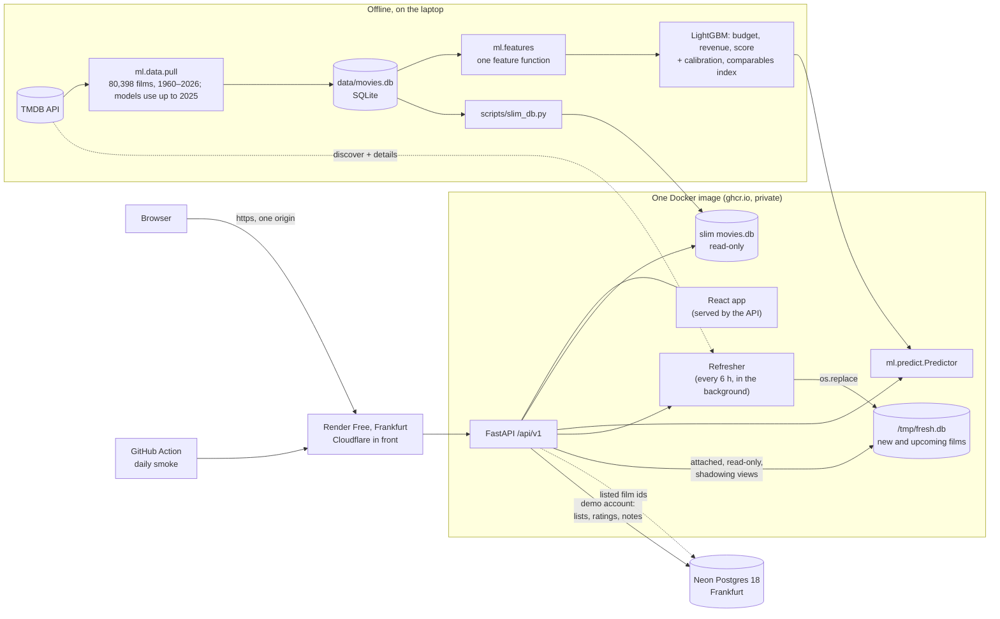
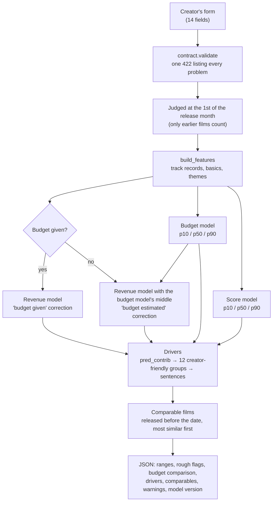

# Architecture

How the parts fit together: the offline pipeline that builds the data and the models, the one container that serves the app, and the path of one prediction. Back to the [README](../README.md).

## The system

- **Movies stay read-only.** The films, people and features are a SQLite file baked into the image; every request opens its own read-only connection.
- **New films live in a second small file.** `fresh.db` (the last 14 days and the next 60, plus every film a user listed) has the same schema as the movie tables and is rebuilt in the background every 6 hours. Each request attaches it and reads both files through temporary views; the models, comparables, career data and autocomplete never do ([Fresh films](app.md#new-arrivals-v12)).
- **User data lives elsewhere.** Render Free's disk is wiped on every sleep and redeploy, so the demo account's lists and notes go to Neon's free Postgres ([The app](app.md#accounts-day-14)).
- **The image is built on the laptop** and pushed to a private registry, because its 470 MB of data and models aren't in git ([Deployment](deployment.md#deployment-day-15)).

## One prediction

- **One feature function** (`ml/features/build.py`) serves training and the app, so they can't drift apart.
- **Every range is calibrated** to hold about 80% of real outcomes; the corrections were learned on out-of-fold predictions ([Models](modeling.md)).
- **The steps** are `ml.predict.Predictor.predict`; the API adds a cache, a rate limit and the same 422 shape for every error ([API](api.md)).
